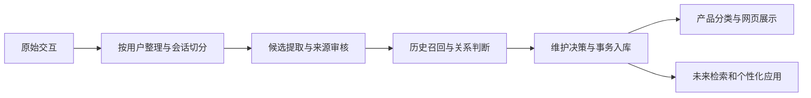

# 项目全景与关系层验收

记录日期：2026-10-22。本文描述本地已保存实验及本轮修改，不将尚未发布的其他本地修复视为已进入远程主分支。

## 我们为什么做这个项目

目标是把儿童设备零散、带噪声的交互记录，整理为有来源、能更新、能够供未来服务使用的用户记忆。会话请求、具体经历、长期特征需要区分；故事角色、助手内容、转写歧义和不确定表达不能直接形成现实画像。

成功不能用条数定义。需要衡量事实正确性、证据是否支持结论、关键遗漏、误记、冲突维护、处理成本和失败恢复。现有实验还没有独立人工金标准，也没有证明记忆改善后续回答。

## 从上往下看完整系统

本轮位于 D：候选已通过来源审核之后，系统要决定它与其他候选、旧事实之间是等价、独立、变化、矛盾还是证据不足。这个位置既影响是否漏记，也影响是否错误合并或覆盖旧记忆。

106维映射属于 F，不是事实真实性的证明。G 的实际业务收益仍待验证。

## 前面完成了哪些工作

| 阶段 | 已完成的工作 | 能证明什么 | 尚不能证明什么 |
| --- | --- | --- | --- |
| 数据与入口 | 整理原始来源，建立按设备的数据包和小样本，选取3台设备、9场会话、41轮 | 能定位到设备、会话、证据及原始行 | 多来源融合、长期规律或全量数据质量已经验证 |
| 来源与控制 | 修复更正、不要保存、来源凭证一致性等问题，建立来源核验与审核记录 | 有效事实有可追溯处理依据，明确控制受到程序约束 | 引文存在就意味着语义一定正确 |
| 执行契约 | 修复模型输出Schema与本地解析器不一致，补离线回归 | 避免因字段契约不同而拒绝本可处理的输出 | 模型不再会生成越界位置或错误关系 |
| 存储与展示 | 修复单用户HTML、跨会话统计与等价合并临时ID；用缓存验证第三台最后一场 | 已有证据显示合并能使用真实数据库ID，原事实与来源保持 | 所有关系语义正确，或所有待办均已消失 |
| 小样本结果 | 最新各设备分别有3、1、14条accepted事实，共18条；6场全部阶段完成 | 核心链路在部分真实样本上运行成功 | 18条都是长期画像，或总体准确率已经达标 |

这些最新结果来自各设备已保存的不同阶段：第三台最后一场采用ID修复后的离线重放，不是统一最终源码从头重跑全部9场。

## 这次具体完成什么

问题有直接证据：关系响应通过批次封套检查后，单项引用可能越界。旧代码会重试失败项，却没有把该项的错误原因带给下一次请求。

本轮建立 `relation-acceptance-v1`：6条真实缓存关系及8条明确标记的合成边界案例。工程参考标签由助手根据原文和预先定义的规则给出，独立人工复核仍待完成，不能当作总体准确率。

本轮修改只增加失败任务的 `validation_feedback`：错误代码、原因、相关证据ID及该任务实际可见的用户字符区间。成功任务不重发；成功条目的缓存键、关系提示词、模型配置和两次逐项尝试上限保持不变。没有自动截短越界引用、补造证据或用新答案覆盖旧缓存。

实验分三种，各自证明不同事情：

1. **固定真实响应回放。** 6条真实关系前后均4条可用、2条待补；4个重试请求的反馈从0个变为4个。证明反馈已送达，不证明真实模型纠错率提升。
2. **合成受控完整流程。** 脚本响应器在收到反馈后返回预定合法响应；验证读取、提取、来源审核、关系重试、数据库、报告和HTML数据通路。前后0→2条有效事实只属于合成测试，不计入三台设备18条结果。
3. **语义反例。** 同句不同对象被错判等价的实际缓存仍被引用校验拦截；另一个明确标记的合成案例展示“合法引用但错误equivalent”仍可能通过协议检查。这项语义风险仍保留，未声称已修复。

本轮不调用外部模型，不进行新Embedding，不补维度映射，不改动旧实验数据库。新增14项自动化回归覆盖反馈隔离、缓存校验失败、部分批次、引用范围、重试预算、更正门禁，以及完整CLI导出和续跑。

## 这对整体项目的意义

- 建立能重复运行的关系验收集，使“是否安全合并、何时保持待办”有固定判例。
- 修复一个具体的反馈链路缺口，给未来真实推理的纠错提供必要信息。
- 区分机械校验、语义质量、完整流程和真实产品效果，避免只以“运行成功”判断记忆质量。
- 让失败原因可见，而不是继续消耗调用预算却无法解释为什么重复失败。

这不是候选去重优化，也不是模型训练；本轮没有测得真实Token节省或真实模型准确率提升。

## 后续按什么顺序推进

| 顺序 | 要解决的问题或假设 | 实验与继续条件 |
| --- | --- | --- |
| 1 | 合法引用仍可能伴随错误关系；工程标签需独立确认 | 人工复核固定判例，增加不同对象、否定、时间和更正反例。比较最终保留的独立事实，不只比较接口是否返回成功 |
| 2 | 多Skill产生重复或粒度不一的候选，放大关系与审核任务 | 用现有提取输出统计候选重叠和唯一关系任务；只对可证明等价的项做保守去重实验。必须不降低关键事实覆盖，再谈降低请求量 |
| 3 | 真实模型看到逐项反馈后是否更容易纠正 | 将来获准使用Token时，用相同输入、同一模型和固定预算作小规模对照。记录成功恢复、误合并及实际成本；离线结果不能替代此实验 |
| 4 | 测试样本上的修复是否能推广 | 将开发样本与留出样本分开；人工检查正确率、遗漏和错误记忆，防止把调过规则的案例当作独立效果验证 |
| 5 | 记忆是否真正改善服务 | 在固定后续问题上比较有无记忆的回答，检查事实使用、过时信息、重复询问与个性化收益 |

106维映射按用户决定暂缓。照片、通话、定位等其他来源，以及大规模扩跑，应在目标和验收明确后逐步接入。

## 怎样理解当前进度

我们已经有一个能在小样本上提取、追溯、维护和展示事实的系统；现在正在建立并加固关系层的质量控制。下一步需要把“哪些记忆值得保留、哪些关系是正确的”变成独立可验证的标准，再验证成本和实际产品收益。
